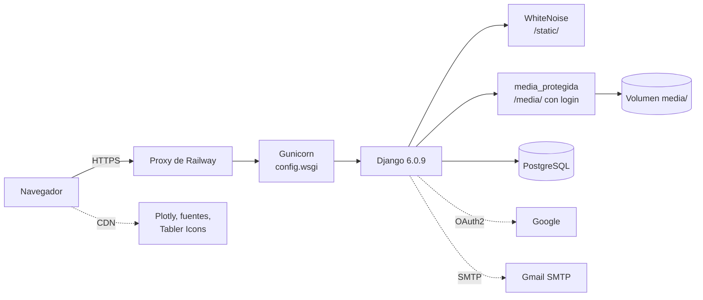
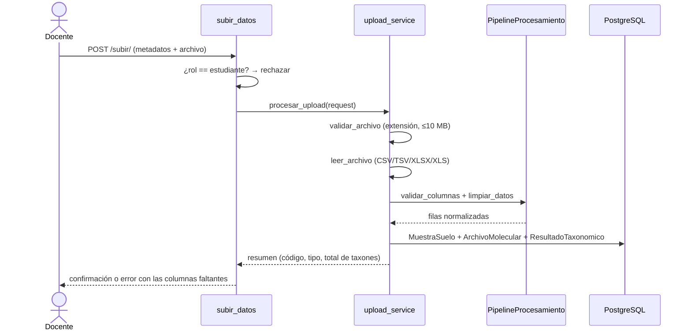
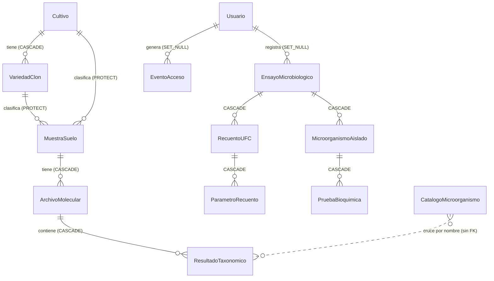

# 3. Documentación técnica

## 3.1 Arquitectura

BioMicro es un monolito Django que renderiza las páginas en el servidor. Los gráficos se dibujan en el navegador con Plotly.js y Chart.js a partir de datos JSON que inyecta la vista. No hay colas de tareas ni procesos en segundo plano: la carga, el análisis y la generación de reportes se ejecutan dentro de la misma petición HTTP.

| Capa | Componente | Detalle |
|---|---|---|
| Presentación | Plantillas Django y JS propio | `templates_base.html` es la base común. `static/analisis/js/chart_theme.js` reúne la paleta, las descargas PNG/SVG y la adaptación a celular. |
| Vistas | `analisis/views/*.py`, `bioquimica/views.py`, `portal/views.py` | Vistas basadas en funciones con `@login_required`. |
| Servicios | `analisis/services/business/` | Lógica de aplicación: carga, análisis, comparación, catálogo, visualización y exportación. |
| Procesamiento | `analisis/services/processing/` | Cálculo científico puro: pipeline de limpieza, abundancias y diversidad. |
| Datos | ORM de Django sobre PostgreSQL | `simple_history` guarda versiones de los modelos clave. |
| Transversal | `middleware.py`, `seguridad.py`, `adapter.py`, `apps.py` | Aceptación de términos, bloqueo de login, reglas de registro y señales de auditoría. |

## 3.2 Módulos

| App / paquete | Responsabilidad | Archivos clave |
|---|---|---|
| `config` | Configuración, URLs raíz y WSGI | `settings.py`, `urls.py` (incluye `media_protegida`) |
| `portal` | Página pública de inicio | `views.inicio` |
| `analisis` | Núcleo: usuarios, muestras, análisis, catálogo, reportes, API y auditoría | ver abajo |
| `bioquimica` | Ensayos de microbiología clásica | `services/pdf_parser.py` (pdfplumber; formatos propio y CIPAL) |

**Servicios de `analisis`:**

| Servicio | Función |
|---|---|
| `upload_service` | Validación del archivo (extensión, máximo 10 MB), detección del separador, lectura con pandas y alta de la muestra |
| `processing/pipeline` | Validación de `COLUMNAS_REQUERIDAS`, limpieza y normalización |
| `processing/abundance` | Abundancias y comparativas |
| `processing/diversity` | Alfa (riqueza, Shannon, Simpson, Pielou), Jaccard, Bray-Curtis vectorizado, gamma, PCoA (Gower 1966), PERMANOVA y PERMDISP (499 permutaciones, semilla 42) |
| `analysis_service` | Top N y análisis diferencial |
| `comparison_service` | Comparación multimuestra; dominantes, compartidos y exclusivos |
| `catalog_service` | Cruce de taxones con el catálogo funcional |
| `visualization_service` | Figuras Plotly (JSON) |
| `export_service` | Reportes PDF (ReportLab) y Excel (openpyxl, con imágenes de Plotly/Matplotlib) |

**Comandos de gestión:**

| Comando | Uso |
|---|---|
| `python manage.py diagnosticar_catalogo --tipo 16S\|ITS` | Diagnostica qué taxones de los resultados coinciden con el catálogo |
| `python manage.py normalizar_catalogo` | Normaliza el campo `nivel` del catálogo de español a inglés |

### Flujo de carga de un archivo

## 3.3 Tecnologías y versiones verificadas

Las versiones salen de `requirements.txt` y coinciden con lo instalado en el entorno local el 4-nov-2026. Las versiones del `README.md` raíz (por ejemplo, Django 5.1.6) **están desactualizadas**.

| Componente | Versión |
|---|---|
| Python (local) | 3.13.1 · producción: [PENDIENTE DE CONFIRMAR] (no hay `runtime.txt`) |
| Django | 6.0.9 |
| django-allauth | 65.17.0 |
| django-unfold | 0.94.0 |
| django-simple-history | 3.12.0 |
| django-import-export | 4.4.1 |
| PostgreSQL (driver) | psycopg2-binary 2.9.12 · servidor: [PENDIENTE DE CONFIRMAR] |
| pandas / numpy / scipy | 3.0.3 / 2.4.6 / 1.17.1 |
| scikit-learn | 1.8.0 |
| plotly (Python) / Plotly.js (CDN) | 6.7.0 / 2.35.2 (2.32.0 en admin y en bioquímica) |
| matplotlib | 3.10.9 |
| reportlab / openpyxl | 4.5.1 / 3.1.5 |
| pdfplumber | 0.11.10 |
| gunicorn / whitenoise | 26.0.0 / 6.12.0 |
| scikit-bio (solo para desarrollo y pruebas) | 0.7.4 |

## 3.4 Modelo de datos

El catálogo **no** tiene clave foránea hacia los resultados: se cruza por nombre de taxón y nivel taxonómico cuando se consulta. Por eso, si se reclasifica una entrada, todos los análisis cambian de inmediato, sin necesidad de reprocesar.

Tienen historial de cambios (`HistoricalRecords`) **Cultivo**, **MuestraSuelo**, **CatalogoMicroorganismo** y **Usuario**. El usuario que hizo cada cambio se toma de `HistoryRequestMiddleware`.

### Diccionario de datos

Todas las tablas tienen `id` (BigAutoField, PK). *FK* indica clave foránea, con la regla de borrado entre paréntesis.

**`analisis_cultivo`**: Cultivo

| Campo | Tipo | Restricciones | Descripción |
|---|---|---|---|
| nombre | varchar(100) | único | Nombre del cultivo |
| descripcion | text | | Descripción |
| imagen | archivo | nulo | Fotografía (`media/cultivos/`) |
| imagen_url | varchar(500) | nulo | URL de imagen externa |

**`analisis_variedadclon`**: Variedad o clon

| Campo | Tipo | Restricciones | Descripción |
|---|---|---|---|
| cultivo | FK Cultivo (CASCADE) | único junto con `nombre` | Cultivo base |
| nombre | varchar(100) | | Nombre de la variedad o clon |
| descripcion | text | | Descripción |

**`analisis_muestrasuelo`**: Muestra de suelo

| Campo | Tipo | Restricciones | Descripción |
|---|---|---|---|
| codigo | varchar(100) | único | Código de la muestra |
| cultivo | FK Cultivo (PROTECT) | | Cultivo |
| variedad_clon | FK VariedadClon (PROTECT) | | Variedad o clon |
| tipo_muestra | varchar(100) | valor por defecto «Suelo» | Tipo de muestra |
| observaciones | text | | Observaciones de campo |
| fecha_registro | datetime | automático | Fecha de ingreso |
| localidad | varchar(100) | indexado | Localidad |
| finca_lote | varchar(150) | | Finca o lote |
| altitud | entero | nulo, indexado | Altitud (msnm) |

**`analisis_archivomolecular`**: Archivo de secuenciación

| Campo | Tipo | Restricciones | Descripción |
|---|---|---|---|
| muestra | FK MuestraSuelo (CASCADE) | | Muestra |
| tipo_analisis | varchar(10) | `16S` \| `ITS`, indexado | Marcador |
| archivo | archivo | | Archivo original (`media/archivos_moleculares/`) |
| fecha_carga | datetime | automático | Fecha de subida |

**`analisis_resultadotaxonomico`**: Fila del perfil taxonómico

| Campo | Tipo | Restricciones | Descripción |
|---|---|---|---|
| archivo | FK ArchivoMolecular (CASCADE) | | Archivo de origen |
| kingdom, phylum, tax_class, order, family, genus, species | varchar(255) | kingdom, phylum, family, genus y species indexados | Jerarquía taxonómica |
| num_hits | entero | | Conteo de lecturas |
| porcentaje_hits | float | | Abundancia relativa (%) |

**`analisis_catalogomicroorganismo`**: Catálogo funcional

| Campo | Tipo | Restricciones | Descripción |
|---|---|---|---|
| nombre | varchar(255) | único junto con `nivel` | Nombre científico |
| nivel | varchar(50) | `genus`, `species`, `family`, `order`, `class`, `phylum` | Nivel taxonómico |
| clasificacion | varchar(30) | `benefico`, `fitopatogeno`, `neutral`, `sin_clasificar` | Rol funcional |
| descripcion | text | | Descripción agronómica |
| referencia | text | | Referencia bibliográfica |
| marcador | varchar(10) | `16S` \| `ITS` | Marcador molecular |

**`analisis_usuario`**: Usuario (hereda de `AbstractUser`; se listan los campos propios y los relevantes)

| Campo | Tipo | Restricciones | Descripción |
|---|---|---|---|
| username / email | varchar | `username` = correo, asignado automáticamente | Credencial de acceso |
| rol | varchar(20) | `admin`, `docente`, `estudiante` | Rol en la plataforma |
| is_staff | bool | se sincroniza con `rol == 'admin'` | Acceso al panel |
| avatar | archivo | nulo | Foto de perfil (`media/avatars/`) |

**`analisis_eventoacceso`**: Auditoría de accesos

| Campo | Tipo | Restricciones | Descripción |
|---|---|---|---|
| tipo | varchar(20) | `login_ok`, `login_fallido`, `logout` | Evento |
| usuario | FK Usuario (SET_NULL) | nulo | Usuario (si existe) |
| username_intentado | varchar(150) | | Correo ingresado |
| ip_address | IP | nulo, indexado | IP del cliente |
| user_agent | varchar(255) | | Navegador o dispositivo |
| fecha | datetime | automático, indexado | Fecha y hora |

**`bioquimica_ensayomicrobiologico`**: Ensayo

| Campo | Tipo | Restricciones | Descripción |
|---|---|---|---|
| codigo | varchar(50) | único | Código del ensayo |
| tipo | varchar(20) | `recuento`, `aislamiento` | Tipo de ensayo |
| nombre_muestra / etiqueta | varchar(200) / text | | Identificación de la muestra |
| fecha_recepcion, fecha_ejecucion, fecha_reporte | date | nulo | Fechas del laboratorio |
| es_cipal | bool | | El PDF tiene formato CIPAL |
| temp_ambiental, humedad_ambiental | decimal | nulo | Condiciones ambientales |
| observaciones | text | | |
| archivo_pdf | archivo | nulo | PDF original (`media/bioquimica_pdfs/`) |
| registrado_por | FK Usuario (SET_NULL) | nulo | Usuario que lo registró |
| fecha_registro | datetime | automático | Fecha de ingreso |

**`bioquimica_recuentoufc`**: `ensayo` (FK, CASCADE), `tipo_organismo` (`hongo`, `bacteria`, `otro`), `nombre`, `coeficiente` (decimal), `exponente` (entero; UFC = coeficiente × 10ⁿ), `menor_que_limite` (bool) y `orden`.

**`bioquimica_parametrorecuento`**: `recuento` (FK, CASCADE), `numero`, `nombre` y `valor` (texto). Guarda los parámetros de los reportes CIPAL.

**`bioquimica_microorganismoaislado`**: `ensayo` (FK, CASCADE), `tipo` (`hongo`, `bacteria`), `nombre_cientifico` y la jerarquía (`dominio`, `filo`, `clase`, `orden_taxonomico`, `familia`, `genero`, `especie`).

**`bioquimica_pruebabioquimica`**: `microorganismo` (FK, CASCADE), `numero`, `nombre_prueba` y `resultado`.

**Tablas del framework que se usan para auditoría:** `django_admin_log` (`LogEntry`: acciones del admin y aceptación de términos, con `object_repr = "Aceptación de Términos y Política de privacidad v<versión>"`) y las tablas `historical*` de simple-history.

## 3.5 API REST (`/api/v1/`)

Es de solo lectura, en JSON y exige una sesión iniciada (`@login_required` y `@require_GET`). No tiene autenticación por token: está pensada para que la consuma el propio navegador o un script que tenga la cookie de sesión. Las rutas `/api/` quedan fuera del control de aceptación de términos.

Formato de la respuesta: `{"ok": true, "data": …}` cuando todo va bien, o `{"ok": false, "error": "mensaje"}` con código 4xx cuando hay un error.

| Método y ruta | Parámetros GET | Respuesta (`data`) |
|---|---|---|
| `GET /api/v1/muestras/` | `cultivo_id` (numérico), `q` (busca en el código) | Lista de `{id, codigo, cultivo, variedad, localidad, tipo_muestra, altitud, fecha}` |
| `GET /api/v1/muestras/<id>/` | `tipo` (`16S` por defecto), `top_n` (10 por defecto) | `{muestra: {id, codigo, cultivo, localidad}, tipo, top_n, total_taxa, taxonomia: [...]}` |
| `GET /api/v1/catalogo/` | `marcador` (`16S`\|`ITS`), `clasificacion`, `q`, `page` (50 por página) | Entradas del catálogo, paginadas |
| `GET /api/v1/catalogo/<nombre>/` | `marcador` (`16S` por defecto) | `{id, nombre, nivel, marcador, clasificacion, descripcion, referencia}` |
| `GET /api/v1/estadisticas/` | — | `{muestras, archivos_total, archivos_sin_procesar, resultados_taxonomicos, catalogo: {total, beneficos, fitopatogenos, neutrales, sin_clasificar}}` |

## 3.6 Integraciones externas

| Servicio | Uso | Configuración |
|---|---|---|
| Google OAuth2 | Login y registro con Google (PKCE) | `GOOGLE_CLIENT_ID`, `GOOGLE_CLIENT_SECRET`. La URI de callback es `https://<dominio>/accounts/google/login/callback/`. |
| SMTP (Gmail) | Recuperación de contraseña, correo de bienvenida | `EMAIL_*`. Sin credenciales, los correos se escriben en la consola. |
| CDN (Plotly, Google Fonts, Tabler Icons, jsDelivr) | Gráficos, tipografías e íconos | Sin configuración. Sin acceso a internet, los gráficos no se dibujan. |
